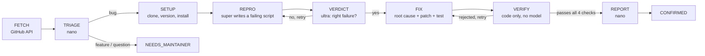

# Issue-to-Repro

**Paste a GitHub issue. Get back a verified reproduction, a patch, and a regression test, or an honest "I couldn't".**

An agent for Python libraries that reads a bug report, reproduces it in an isolated
**Nebius Token Factory Sandbox**, has a separate **NVIDIA Nemotron** model judge whether the failure
really matches the report, and only then proposes a fix. A fix counts only if its regression test
**fails on the original code and passes on the patched code**, which is checked by running it, never
by asking a model.

- **Live demo:** _add the Vercel URL here_
- **Demo video (< 3 min):** _add the YouTube link here_
- **Built for:** NVIDIA × Nebius Hackathon, Coding and Agentic Engineering track
- **License:** MIT

---

## What it does

Every run ends in exactly one outcome:

| Outcome | Meaning | What you get |
|---|---|---|
| **CONFIRMED** | Bug reproduced, fix verified | Repro script, failing output, patch, regression test, and proof the test fails before and passes after |
| **NOT_REPRODUCED** | The report could not be reproduced | A comment asking the author for the specific missing detail |
| **NEEDS_MAINTAINER** | A feature request, a design question, too ambiguous, or no verifiable patch | Why it stopped, plus the evidence gathered so far |
| SETUP_FAILED / ERROR | The project could not be installed, or a budget/step limit was hit | The exact error, so nothing fails silently |

The web UI streams each step live: a stage timeline on the left, the current artifact (script,
terminal output, verdict, diff, final comment) on the right, and per-tier token use and dollar cost on top.
Finished runs can be **replayed** without calling any model.

## How Nemotron and Token Factory are used

All inference goes through **Nebius Token Factory** (OpenAI-compatible `chat/completions`), and every
model is an **NVIDIA Nemotron 3** model. Stage code never names a model: it asks for a *tier*, and
configuration maps tiers to model IDs (`src/itr/llm.py`).

| Tier | Model (Token Factory ID) | Used for | Why this size |
|---|---|---|---|
| **nano** | `nvidia/NVIDIA-Nemotron-3-Nano-30B-A3B` | TRIAGE (bug or not?), REPORT (draft the comment) | Cheap, fast, and these tasks are easy |
| **super** | `nvidia/nemotron-3-super-120b-a12b` | SETUP fallback, REPRO scripts, first FIX attempts | The everyday workhorse for writing code |
| **ultra** | `nvidia/Nemotron-3-Ultra-550b-a55b` | VERDICT (does the failure match the issue?), FIX from the 3rd attempt | The judgment calls that decide what we claim |

- **Structured output everywhere.** Every call that feeds program logic uses Token Factory's strict
  `json_schema` mode, then our own validation with one retry that feeds back the exact error.
- **Thinking-aware limits.** Nemotron reasons before answering, and reasoning tokens count toward
  `max_tokens`, so each tier has its own generous limit (`LLM_MAX_TOKENS_*`). Only the answer field is ever read.
- **Cost in dollars, per tier.** Every call is logged with tier, tokens, latency and cost. Each run has
  token, time and dollar caps (default $0.15), and the UI header shows the running total live.
- **Code runs in Nebius Sandboxes.** Each run gets a VM-isolated sandbox. Its chain-of-images model lets
  us save the installed environment once (`snapshot()`) and branch from it, so the fail-before and
  pass-after test runs start from byte-identical states. Our API keys are never passed into the sandbox.

## Why you can trust a CONFIRMED



1. **The script asserts the correct behaviour**, so it fails while the bug exists and passes once fixed.
   Whether it failed is classified by code, not by a model.
2. **A separate judge.** VERDICT (ultra) answers two checkable questions: does the observed failure match
   the reported one, and would this script pass if the library were fixed? Code makes the decision, and the
   model cannot talk itself into "yes".
3. **A mechanical gate.** VERIFY accepts a patch only if (1) the new test fails on the original code,
   (2) passes on the patched code, (3) the original reproduction now passes, and (4) no previously passing
   test breaks. Patches may not touch tests, docs or configuration.
4. **Traps in the evaluation.** The eval set includes a Windows-only bug and a feature request, where
   claiming CONFIRMED would be a false positive.

## Results

Evaluated on real, closed GitHub issues from `tabulate`, `cachetools` and `click`, each pinned to the commit
just before its fix (`eval/cases.yaml`), so the correct answer is known independently.

| Metric | Result |
|---|---|
| Reproduced (real bugs) | _fill in from `eval/run_eval.py`_ |
| Verified fixes | _fill in_ |
| False positives on trap cases | _fill in_ |
| Median cost per case | _fill in_ |
| Tokens by tier (nano / super / ultra) | _fill in_ |

Early measurements with the real models are recorded in `decisions.md`: TRIAGE was right on 7 of 8 cases,
including both traps (D42), and the Ultra judge classified 11 of 11 labelled reproduction attempts correctly
(D44).

## Quick start

Requires Python 3.10+ and a Nebius Token Factory API key with Sandboxes enabled.

```bash
git clone https://github.com/JaySPX05/issue_to_repro
cd issue_to_repro
python -m venv .venv
source .venv/bin/activate            # Windows: .venv\Scripts\activate
pip install -e ".[web,nebius,dev]"
cp .env.example .env                 # Windows: copy .env.example .env
```

Fill in `.env` (it is gitignored):

```ini
NEBIUS_API_KEY=...
NEBIUS_PROJECT_ID=...
MODEL_NANO=nvidia/NVIDIA-Nemotron-3-Nano-30B-A3B
MODEL_SUPER=nvidia/nemotron-3-super-120b-a12b
MODEL_ULTRA=nvidia/Nemotron-3-Ultra-550b-a55b
SANDBOX_BACKEND=nebius
GITHUB_TOKEN=...                     # optional, read-only; avoids GitHub's 60 requests/hour limit
```

Check the setup, then start the app:

```bash
python scripts/check_setup.py        # key, models visible, GitHub access
python scripts/check_models.py       # each tier answers and supports JSON mode
python -m itr.api                    # http://127.0.0.1:8000
```

Open the page, paste a GitHub issue URL (for example `https://github.com/pallets/click/issues/2877`) and press **Run**.

**No key yet?** `python scripts/seed_demo_run.py` loads one labelled sample run, so you can try the UI and Replay offline.

**Local sandbox instead of Nebius:** set `SANDBOX_BACKEND=docker` with Docker Desktop running.

## Configuration

| Variable | Default | Purpose |
|---|---|---|
| `NEBIUS_API_KEY`, `NEBIUS_PROJECT_ID` | (required) | Token Factory inference and Sandboxes |
| `NEBIUS_BASE_URL` | `https://api.tokenfactory.nebius.com/v1/` | Inference endpoint |
| `MODEL_NANO`, `MODEL_SUPER`, `MODEL_ULTRA` | (required) | Model ID per tier |
| `LLM_MAX_TOKENS_NANO/SUPER/ULTRA` | 4000 / 12000 / 16000 | Output limit per tier (includes reasoning) |
| `SANDBOX_BACKEND` | `docker` (`nebius` in the container) | Where code runs |
| `ITR_DB_PATH` | `data/itr.db` | SQLite file for runs and events |
| `MAX_CONCURRENT_RUNS` | 2 | Further runs get HTTP 429 |
| `ALLOW_NEW_RUNS` | `true` | `false` makes a public demo replay-only |
| `RUN_MODE` | `background` (`inline` on Vercel) | `inline` runs each job inside the request that streams it |
| `RUN_MAX_SECONDS` | 900 (270 inline) | Time budget per run |
| `GITHUB_TOKEN` | (optional) | Higher GitHub API rate limit |

## API

| Method | Path | Description |
|---|---|---|
| `POST` | `/runs` | `{"issue_url": "..."}` → `{"run_id": "..."}` |
| `GET` | `/runs/{id}/events` | Server-sent events: stored events, then live ones; resumes with `Last-Event-ID` |
| `GET` | `/runs/{id}` | Final state: stages, artifacts, tokens per tier, cost, outcome |
| `POST` | `/runs/{id}/replay?speed=4` | Re-streams a finished run as a new run, without any model call |
| `GET` | `/runs/live?issue_url=...` | Starts a run and streams it in the same request (serverless hosts) |
| `GET` | `/runs/{id}/replay-stream?speed=4` | Replays a finished run in one request, writing nothing |
| `GET` | `/runs` | Recent runs |

## Deploy

**Vercel (our hosted demo).** Import this repo at vercel.com → New Project; Vercel finds the FastAPI
`app` in `app.py` and the 300-second limit in `vercel.json`. Add `NEBIUS_API_KEY`, `NEBIUS_PROJECT_ID`
and the three `MODEL_*` variables under Settings → Environment Variables, then deploy.

Vercel functions keep nothing between requests and stop after 5 minutes on the free plan, so `app.py`
switches the app to single-request mode: a run lives inside the request that streams it to the browser,
with a 270-second time budget so it ends cleanly before the platform limit. Real runs saved with
`python scripts/export_run.py <run_id> <name>` into `demo_runs/` are loaded by every new instance, so the
demo always has finished runs to open and replay.

**Docker (any container host, or locally).** The `Dockerfile` serves the API and UI on one port and
defaults to Nebius Sandboxes:

```bash
docker build -t issue-to-repro .
docker run -p 7860:7860 --env-file .env issue-to-repro
```

## Project layout

```
src/itr/
  agent/            state machine, stages, prompts, budget        (agent core)
  github.py         issue fetching                                (agent core)
  llm.py            Token Factory client, tier routing, logging   (platform)
  sandbox/          Sandbox interface; nebius.py, local_docker.py (platform)
  store.py          SQLite runs + events                          (platform)
  api.py            FastAPI + server-sent events                  (platform)
web/                static UI, no build step                      (platform)
eval/               real-issue evaluation cases
scripts/            setup checks, probes, export, deploy
decisions.md        every design decision with its reasoning
FEEDBACK.md         notes on Nebius and NVIDIA tools
```

## Tests

```bash
python -m pytest -q
```

Tests use in-memory fakes for the sandbox and models, so they need no key, network or Docker.
`ITR_DOCKER_TESTS=1` also runs the live Docker sandbox test.

## License

MIT. See [LICENSE](LICENSE).
